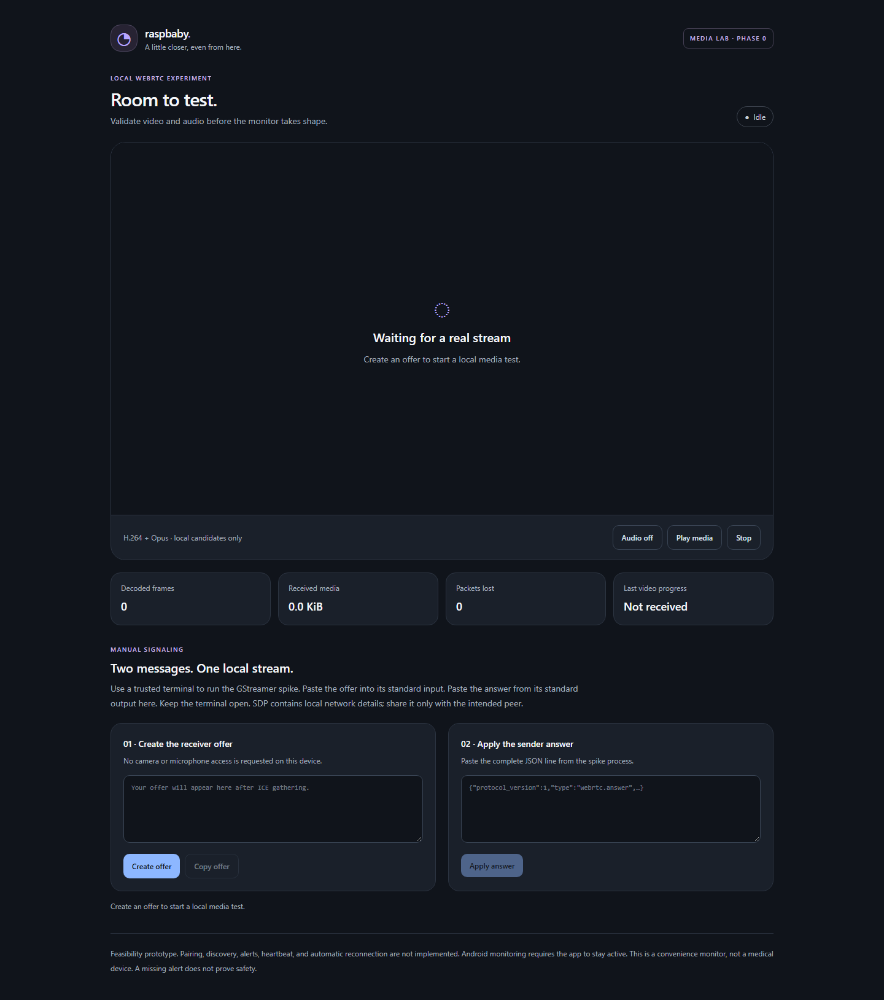
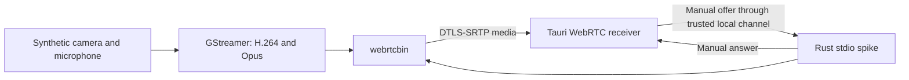

# Raspbaby Monitor

A local-first baby monitor for a Raspberry Pi, Windows, and Android.
The target design uses Rust, GStreamer WebRTC, and a shared Tauri 2 application.
Normal operation will not need a cloud service, account, or subscription.

**Current status: Phase 0 media experiment and Phase 1 foundation.**
This is not a working baby-monitor release. Pi capture, secure pairing,
discovery, detection, alerts, and installation are still pending. The first
milestone requires live video and audio in both Windows and Android Tauri apps.
See the [feasibility report](docs/feasibility.md) for the open checks.



## Start development

Install Rust stable, Node.js, and the pnpm version in `package.json`.

```powershell
pnpm install --frozen-lockfile
pnpm dev
```

This starts the receiver UI. Media requires the native GStreamer spike and
manual signaling. Follow [the development guide](docs/development.md) for the
complete workflow, platform prerequisites, and build commands.

```powershell
cargo test --locked
cargo clippy --locked --all-targets -- -D warnings
pnpm check
pnpm test
pnpm build
```

## Architecture



The spike opens no HTTP or WebSocket control listener. It does not use public
STUN or TURN servers. Manual signaling is a test tool; production pairing and
authenticated control must be implemented before network product use.

## Repository

- `crates/raspbaby-media`: Synthetic source, pipeline configuration, and optional native runtime.
- `crates/raspbaby-daemon`: Bounded standard-input signaling experiment.
- `crates/raspbaby-protocol`: Validated versioned messages and TypeScript generation.
- `crates/raspbaby-detection`: Reserved crate; detection is deferred by the media gate.
- `apps/monitor`: Shared React, TypeScript, Tailwind, and Tauri receiver.
- `packages/protocol-client`: Generated contract and runtime input validation.
- `scripts/probe_pi.py`: Read-only Pi capability probe.

The required hardware target is a Pi 4 with 1 GB RAM, USB camera and microphone,
and Raspberry Pi OS Lite ARM64 based on Debian 13. No camera or OS image is
validated yet. No media recording is implemented.

Read the [approved plan](docs/implementation-plan.md), [current backlog](docs/backlog.md),
[architecture decisions](docs/decisions/0001-media-feasibility-gate.md),
[validation results](docs/validation.md), and [security boundary](SECURITY.md).

This is a convenience monitor, not a medical device. Detection will be
best-effort. Connection loss must be visible. A missing alert does not prove
that a baby is safe. Android background monitoring is outside the MVP.

MIT license. See [LICENSE](LICENSE).
