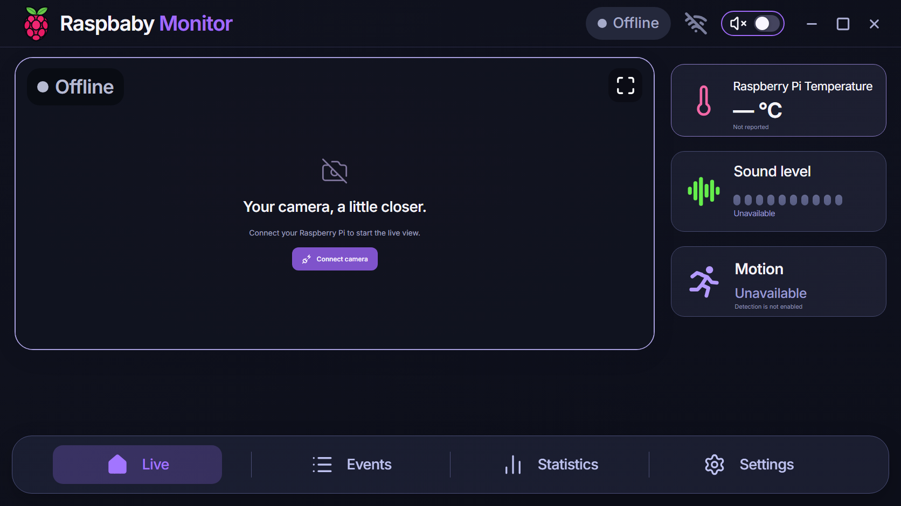
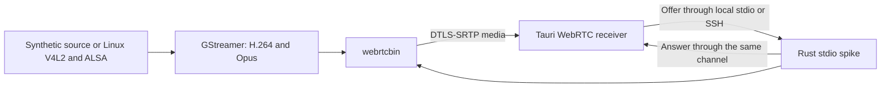

# Raspbaby Monitor

A local-first baby monitor for a Raspberry Pi, Windows, and Android.
The target design uses Rust, GStreamer WebRTC, and a shared Tauri 2 application.
Normal operation will not need a cloud service, account, or subscription.

**Current status: media validation and client implementation.**
The client follows the supplied monitor design: a dark camera view, purple
navigation, and temperature, sound, and motion cards. Missing telemetry is
shown as unavailable. It is never replaced with invented measurements.

**Clear real-camera VGA playback is verified in the native Windows app and
Android emulator.** An approved experimental boot service is now installed on
the tested Pi 3B+, using an exact-kernel DWC2 host driver with DMA disabled (PIO)
and stock UVC. Before startup commits, a bounded check must decode three VGA
frames. It permits one controlled rebind retry and restores stock on failure.
Boot backups, computer export, and actual rollback were verified. This is not
a general Pi 4 solution or a product release. See the
[camera report](docs/real-camera-validation.md) and
[persistent compatibility setup](docs/persistent-pio-proposal.md).
The media gate remains open. Product pairing, discovery, detection, alerts,
and production installation remain pending.
See the [feasibility report](docs/feasibility.md) for the open checks.



## Window and background behavior

- Windows: the close button hides the window to the system tray. The tray icon
  or launching the app again restores the same window. **Quit** exits the app.
- Android: real VGA playback continued through Home, screen lock, Back, and
  reopening in the Android 15 emulator. The foreground service uses an ongoing
  notification and a bounded wake lock. Physical-device validation is pending.
- Explicit Stop ends the current media session. Force-stopping Android or
  destroying its playback Activity cannot preserve the WebView receiver.

Read [development](docs/development.md) for setup and current connection steps.

## Activity alert sound

Settings includes a local Murloc sound import, preview, and volume control.
Use the exact [user-selected clip](https://www.youtube.com/watch?v=qMPpnCvCZvw)
as a WAV, MP3, or OGG file up to 1 MiB. One selected sound will be used for
motion and sound-activity alerts. Imported audio stays on that client and is
not included in this repository. Automatic alert triggers await detection.

## Start development

Install Rust stable, Node.js, and the pnpm version in `package.json`.

```powershell
pnpm install --frozen-lockfile
pnpm dev
```

This starts the browser UI. Use the native Windows app for **Connect camera**:

```powershell
pnpm tauri dev
```

Install the Windows OpenSSH client and first establish trusted SSH host-key
and key authentication to the Pi. The app uses existing keys and `known_hosts`;
it does not request or store an SSH password. In Settings, enter the Pi hostname
or private IPv4 address and SSH username, then select **Connect camera**.
Windows exchanges signaling automatically through SSH. The Pi must already have
the native daemon at
`/home/<username>/raspbaby-feasibility/target/debug/raspbaby-daemon`, the tested
camera and microphone, and the reviewed compatibility setup above. The app
does not activate a kernel driver. **Stop** releases its owned camera session.

Follow [the development guide](docs/development.md) for prerequisites, build
commands, and manual signaling for other development clients. This SSH path is
a development connector, not product pairing.

```powershell
cargo test --locked
cargo clippy --locked --all-targets -- -D warnings
pnpm check
pnpm test
pnpm build
```

## Architecture



The spike opens no HTTP or WebSocket control listener. It does not use public
STUN or TURN servers. SSH or manual signaling is a test tool; production pairing and
authenticated control must be implemented before network product use.

## Repository

- `crates/raspbaby-media`: Synthetic and Linux capture sources, pipeline configuration, and optional native runtime.
- `crates/raspbaby-daemon`: Bounded standard-input signaling experiment.
- `crates/raspbaby-protocol`: Validated versioned messages and TypeScript generation.
- `crates/raspbaby-detection`: Reserved crate; detection is deferred by the media gate.
- `apps/monitor`: Shared React, TypeScript, Tailwind, and Tauri receiver.
- `packages/protocol-client`: Generated contract and runtime input validation.
- `scripts/probe_pi.py`: Read-only Pi capability probe.

The planned hardware target remains a Pi 4 with 1 GB RAM. The available test
device is a Pi 3B+ with a Jieli USB webcam/microphone and Raspberry Pi OS Lite
ARM64 based on Debian 13. See the [real-camera report](docs/real-camera-validation.md)
for test scope and limits. The [OS image pin](config/tested-os-image.json) records
the verified download checksum and its provenance. No media recording is implemented.

Read the [approved plan](docs/implementation-plan.md), [current backlog](docs/backlog.md),
[architecture decisions](docs/decisions/0001-media-feasibility-gate.md),
[validation results](docs/validation.md), and [security boundary](SECURITY.md).

This is a convenience monitor, not a medical device. Detection will be
best-effort. Connection loss must be visible. A missing alert does not prove
that a baby is safe. Android background behavior has emulator evidence only.

MIT license. See [LICENSE](LICENSE).
