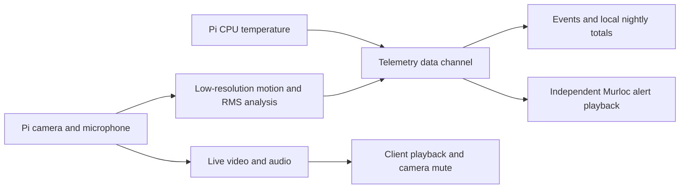

# ADR 0005: Monitor activity on the Pi and separate alerts from playback

Status: Accepted user direction, 2026-11-04. Validation is in progress.

The user requested real motion and sound activity, Pi temperature, recent
activity events, and nightly activity graphs. The user also requires the
selected Murloc sound when activity is detected, even with microphone playback
muted. These requests authorize this monitoring work while the remaining media
feasibility checks stay open.

Analyze a separate low-resolution grayscale video branch and short audio RMS
windows on the Pi. Keep the existing H.264 and Opus media paths. Read CPU
temperature from the Pi thermal interface. Do not label it as room temperature.
Do not claim baby-specific movement or reliable cry recognition.

Send bounded, validated telemetry and event metadata through an ordered WebRTC
data channel on the existing authenticated session. Do not add a control
listener. Do not send or store analysis images or raw audio.

The camera sound switch controls microphone playback only. Alert playback has
its own enabled setting and volume. Unlock its audio output through an explicit
connection or preview action. Prevent overlapping alert clips and suppress
replayed event sounds after reconnect. Sound activity OR motion activity can
start an alert. Repeat while either state remains active, using an independent
interval of 5 seconds by default, adjustable from 5 to 60 seconds. Repeat
notifications do not create extra history events or inflate nightly totals.
Count each confirmed new activity episode; do not suppress those counts with
the notification cooldown.

Persist bounded event metadata and nightly totals on the client. Count motion
and sound events separately. Define a night as 18:00 to 08:00 in the client's
local time zone. State that totals cover received events during monitoring;
do not imply that gaps were observed. Real camera sessions end on explicit
Stop, SSH input closure, or a media failure; the 30-minute test limit remains
only for synthetic sessions.
