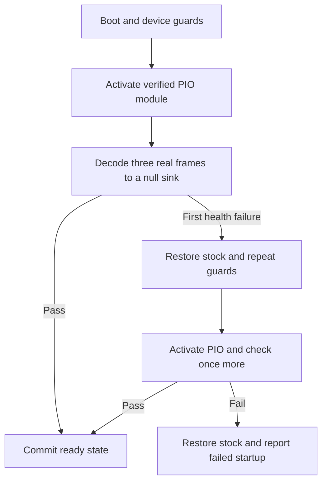

# Persistent Pi 3B+ PIO setup

Status: User-approved experimental installation is active on the tested Pi.
Installation, guarded startup, removal, reinstallation, and two consecutive
health-checked ordinary boots passed hardware checks on 2026-11-04. The first
Windows application connection after each health-checked boot also passed.
The media feasibility gate remains open.

This setup applies only to Raspberry Pi 3 Model B Plus Rev 1.4,
kernel `6.18.50+rpt-rpi-v8`, the stock UVC driver, and camera `4c4a:4a55`.
It accepts only the working module SHA-256:

```text
49e09cb02c24e75b935987ce490d08b9f48077aa7b0fec4e422966e09c54ebb7
```

It accepts only the reviewed normal `config.txt` SHA-256:

```text
fee3e47fe6d168f61882fac6ee6ee2802de4c7d65d8935320287af310e36e887
```

The normal file contains inactive `[cm4]` and `[cm5]` USB settings. Its exact
reviewed hash is accepted; no partial parser attempts to reinterpret other
configurations. A different baseline requires a new review.

## Installed changes

| Path | Purpose |
| --- | --- |
| `/var/lib/raspbaby-pi3-pio/original-config.bin` | Root-only original bytes. Never overwritten or deleted by the tools. |
| `/var/lib/raspbaby-pi3-pio/installation.json` | Original, installed, and file hashes; installation state. |
| `/usr/local/lib/raspbaby/pi3-dwc2-pio/6.18.50+rpt-rpi-v8/` | Root-owned module and scripts, outside `/lib/modules`. No alias auto-load. |
| `/boot/firmware/config.txt` | Original bytes plus one marked `[all]` include block. |
| `/boot/firmware/raspbaby-pi3-pio.txt` | `dtoverlay=dwc2,dr_mode=host` for this reviewed board. |
| `/etc/systemd/system/raspbaby-pi3-pio.service` | Explicit opt-in service enabled for the next boot. |
| `/run/raspbaby-persistent-pio/` | Private per-boot restoration state and lock. |

Installation does not start the service or reboot. It does not replace the
kernel, stock modules, UVC driver, normal command line, or firmware. It does
not start a monitoring pipeline or expose a network service. Service startup
does perform the short in-memory decode check described below.

At boot, the oneshot service waits for `network-online.target`. It checks the
exact board and kernel, MMC root, built-in `wlan0` management route, no USB
storage, no capture consumers, stock UVC, the camera, and the module hash. It
accepts only stock `dwc2` with an empty override. It arms independent startup
recovery before unbinding USB, then commits success under a shared lock.
Before activation and after udev settles, it waits up to 12 seconds for the stable video path, USB
camera identity, stock UVC version, and ALSA capture card and device node.
Each startup attempt uses a unique recovery unit with `--collect`. After a
successful commit, it stops only that attempt's timer. A queued older recovery
checks committed state under the same lock and takes no action.
Startup has a 90-second systemd timeout. Stop retains its 45-second timeout.
The independent startup recovery timer is armed once for 75 seconds. No
attempt silently loads a module for another kernel or fabricates an SSH session.

Startup now requires executable `/usr/bin/ffmpeg` before any driver change.
After binding PIO, FFmpeg must decode three MJPEG VGA frames successfully
within eight seconds, report at least three frames, and end its progress log.
The output uses the null muxer: no footage or image file is saved. Timeout
kills and waits for FFmpeg so that the camera is released. Only a decode health
failure permits one retry. The service first restores stock, repeats readiness
and full safety checks, then rebinds the same verified module once. Another
health failure restores stock and fails startup. Other guard failures are never
retried. This startup check is experimental and does not prove long-term health.

The entire USB tree resets. USB Ethernet, cameras, microphones, and keyboards
can disconnect. Use built-in Wi-Fi and MMC root. A kernel lockup can still
defeat software recovery. Physical access must be available for the first
installation and reboot test. This does not yet support production monitoring.

## Review and installation commands



The user approved and completed this workflow on the tested Pi. Use these
commands only with the exact reviewed board and artifacts. First stop all
capture. Restore any temporary PIO trial and stop its
recovery timer. Wait for the foreground activation process to exit. The guard
also rejects old `run_host_pio_trial.py` processes, legacy recovery units, and
`/run/raspbaby-pio-test`. Use an ordinary reboot if ownership is uncertain.

From the reviewed checkout on the Pi, stage only the reviewed scripts and the
exact working module in a root-owned directory. Replace the module source path
below with the verified artifact path. All script source files and parent
directories must be root-owned and not writable by a group or other users.

```sh
sudo install -d -m 0700 /root/raspbaby-pio-review
sudo install -m 0600 tools/pi3-dwc2-pio/persistent/support.py tools/pi3-dwc2-pio/persistent/service.py tools/pi3-dwc2-pio/persistent/install.py /root/raspbaby-pio-review/
sudo install -m 0600 tools/pi3-dwc2-pio/runtime.py /root/raspbaby-pio-review/
sudo install -m 0600 /path/to/verified/dwc2_pio_test.ko /root/raspbaby-pio-review/dwc2_pio_test.ko
sudo sha256sum /root/raspbaby-pio-review/dwc2_pio_test.ko
sudo --preserve-env=SSH_CONNECTION python3 /root/raspbaby-pio-review/install.py install --module /root/raspbaby-pio-review/dwc2_pio_test.ko --accept-persistent-usb-reset
```

Review the backup and installation hashes before a separate, approved ordinary
reboot. Copy the original backup and its hash off the Pi for physical recovery.
The installer enables the unit for the next boot. It does not request that
reboot. Existing files, an unknown baseline, another loaded test module, or an
active temporary recovery process stop installation. An incomplete prior
installation requires manual review; the installer never overwrites its backup.

After a reboot, verify the service, driver binding, clear camera picture,
audio, CPU and memory use, and another ordinary reboot. The validation record
below identifies the completed checks. This remains an experimental setup.

## Hardware validation on 2026-11-04

| Check | Result |
| --- | --- |
| Approved installation | Passed. Original backup and installation manifest were verified. The original backup was exported to the Windows computer and its hash was checked. |
| First ordinary boot | Failed safely. Udev settled before camera re-enumeration completed. The service restored stock `dwc2`. |
| Narrow startup fix | Added the bounded readiness wait and unique recovery units. A guarded service retry passed. |
| Actual removal | Passed. Stock `dwc2` was bound, the test module was unloaded, the unit and include were absent, and normal config bytes matched the exact original hash. |
| Fresh reinstallation | Passed after the retained validation records were archived by a separate reviewed root operation. The new original backup was verified. |
| Next ordinary boot | Passed at 10:59:50 CET. The service was active/exited with status 0 and `dwc2_pio_test` was bound automatically. |
| Independent direct RAM capture | A 10-second sample produced 19 distinct frames out of 19 sampled frames, no JPEG errors, and a clear full-color picture. |
| Earlier repeat boot without decode health | Failed capture despite a bound PIO driver. Only tiny invalid buffers arrived. A guarded full host rebind recovered clear capture. Driver binding alone was not sufficient. |
| Startup decode check | Added three-frame decode validation and at most one health-only retry. A manual guarded start passed. |
| Deployment unit correction | A Windows-generated unit used backslashes and failed without activating PIO. It was regenerated with Linux paths before validation continued. |
| Health-checked boot A | Passed automatically at 11:23:11 CET on attempt 1. First Windows connection: 48 video frames, 146,880 audio samples, clear 640×480 RAM frame; Stop released capture. |
| Health-checked boot B | Passed automatically at 11:26:00 CET on attempt 1. First Windows connection: 50 video frames, 146,400 audio samples, clear 640×480 RAM frame; Stop released capture. |

The installed config SHA-256 was:

```text
19268d2e7f619d735f44d14c75fe06190fab708d2374eecb5c0a62fbaeb22b69
```

The corrected service file SHA-256 was:

```text
766be63327a9dd4fe309b92153d13a115d70be46753c36581bb137e36e5fc4f9
```

The first removal retained the original backup and versioned recovery files,
as designed. Before the fresh reinstall, a separate verified root operation
archived the state at `/var/lib/raspbaby-pi3-pio-removed-validation-20261104`
and the version directory with suffix `-removed-validation-20261104`.
The installer did not overwrite those backups. Short capture and reboot checks
do not prove long-running stability, audio/video synchronization, Pi 4 support,
or production readiness.

## Removal and physical recovery

Stop all capture first. Removal refuses active video, media, or sound users.

```sh
sudo --preserve-env=SSH_CONNECTION python3 /usr/local/lib/raspbaby/pi3-dwc2-pio/6.18.50+rpt-rpi-v8/install.py uninstall --accept-persistent-usb-reset
```

Removal stops the service without holding its restoration lock. If PIO is
loaded, it restores stock `dwc2` with the exact runtime safety guards. It then
disables the unit and restores the original config bytes when the installed
hash still matches. If unrelated edits exist, it removes only the unchanged
marked block. A changed or duplicated block requires manual review. It removes
only the unchanged unit and include files. The backup and versioned recovery
files remain. A later ordinary reboot returns to legacy `dwc_otg` selection.

If PIO is absent, boot-file rollback can proceed after a kernel upgrade or camera
removal. It still requires root, the correct board, MMC root, the actual Wi-Fi
SSH route, no consumers, trusted metadata, and intact owned files. It does not
attempt USB driver changes on the unknown kernel. A different kernel disables
automatic activation; rebuild and repeat validation before updating this pin.

If Wi-Fi or SSH is unavailable, shut down or remove power and insert the MMC
card into the Windows computer. Open its FAT boot partition. Restore the
previously exported original `config.txt` after you verify its recorded hash
and account for later user edits. Alternatively, remove only the exact marked
Raspbaby include block. Do not change the kernel or stock modules. Boot
normally. The service refuses the legacy driver before any USB change. After
Wi-Fi SSH returns, run `sudo systemctl disable --now raspbaby-pi3-pio.service`.
Retain the backup and installation metadata for manual cleanup review. This
recovery does not require Windows to mount the Linux root partition. Never
apply a guessed disk path or overwrite an unrelated config.

## Offline validation

```powershell
python -m unittest discover -s tools/pi3-dwc2-pio/persistent -p test_persistent.py -v
```

The tests cover exact baseline selection, config rollback and unrelated edits,
module startup ordering, consumer refusal, legacy trial overlap, bounded unit
settings, and rollback after a replace/fsync failure. They use temporary files
and mocks. They do not execute installer operations or access Pi hardware.
All 26 offline tests, Python compilation, and whitespace checks passed on the
Windows development host. Hardware results are recorded separately above.
